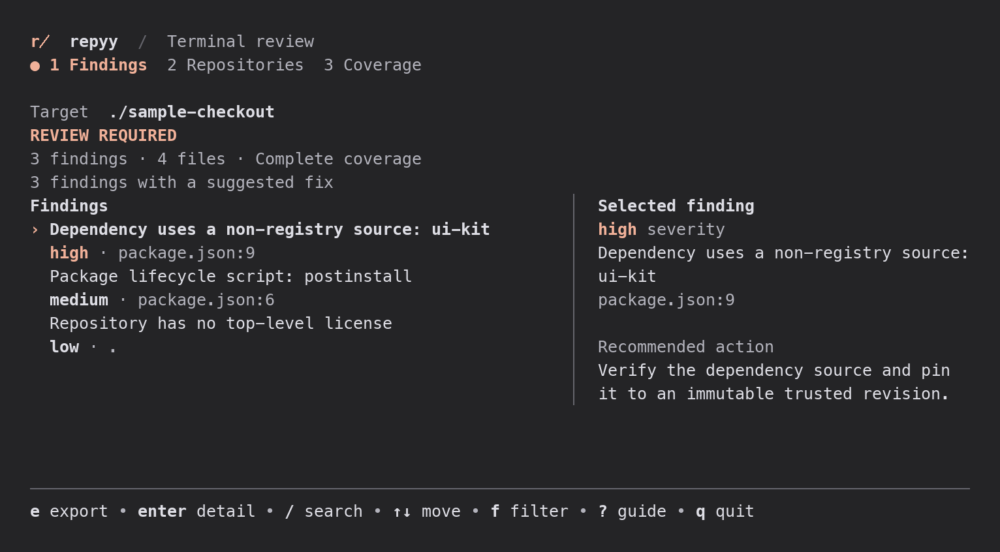

# repyy

[](https://github.com/Kevin-Umali/repyy/actions/workflows/ci.yml)
[](https://github.com/Kevin-Umali/repyy/actions/workflows/codeql.yml)
[](LICENSE)

Scan an unfamiliar repository before installing dependencies, starting the project, or opening it
in your IDE. Repyy reads files for static analysis and shows findings alongside their source
locations and scan coverage. Review the result before deciding whether to run the project.

[Documentation](https://repyy.dev/docs/) · [Sample HTML report](https://repyy.dev/demo/sample/sample.html) · [Trust and limitations](https://repyy.dev/trust/)



## Quick start

Download Repyy from [GitHub Releases](https://github.com/Kevin-Umali/repyy/releases) or use a package manager.
[Verify a downloaded release](https://repyy.dev/verification/)

```sh
# macOS
brew install --cask Kevin-Umali/tap/repyy

# Windows PowerShell
scoop bucket add repyy https://github.com/Kevin-Umali/scoop-bucket
scoop install repyy/repyy

# Any platform with Go
go install github.com/Kevin-Umali/repyy/cmd/repyy@latest
```

Scan a local checkout and review the findings in your terminal.

```sh
repyy version
repyy scan ./unfamiliar-repository --format tui
```

Press Enter to inspect a finding or `e` to export the report. [Interactive review controls](https://repyy.dev/cli/#interactive-review)

To save an HTML report from the command line, run the scan with an output path.

```sh
repyy scan ./unfamiliar-repository --format html --output repyy-report.html
```

Open `repyy-report.html` in a browser. Treat reports as sensitive review data. A static scan can
miss risky behavior. If you see `SCAN INCOMPLETE`, check the reported errors and coverage limits.

## Agent skill

The optional [Repyy skill](skills/repyy/SKILL.md) gives compatible coding agents instructions for
scanning repositories and reviewing coverage. Install the CLI and skill separately.

```sh
npx skills add Kevin-Umali/repyy --skill repyy
```

The installer needs Node/npm, Git, and network access. [Agent skill setup and optional helpers](https://repyy.dev/agent-skill/)

## Contributing

```sh
git clone https://github.com/Kevin-Umali/repyy.git
cd repyy
make check
make security
```

Read [CONTRIBUTING.md](CONTRIBUTING.md) before changing detections, output, network behavior, or
report compatibility. See [SECURITY.md](SECURITY.md) for private vulnerability reports.
For the Astro site, see [site development and deployment](site/README.md).

## License

MIT. Third-party intelligence sources are listed in [NOTICE](NOTICE).
